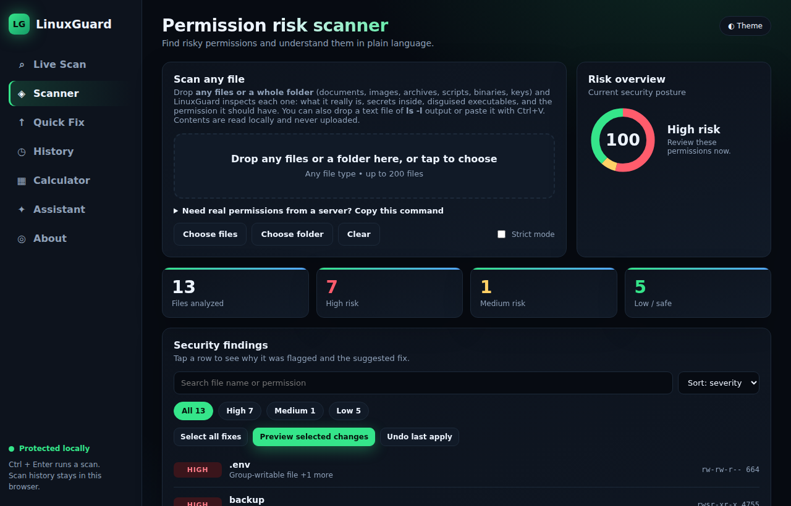
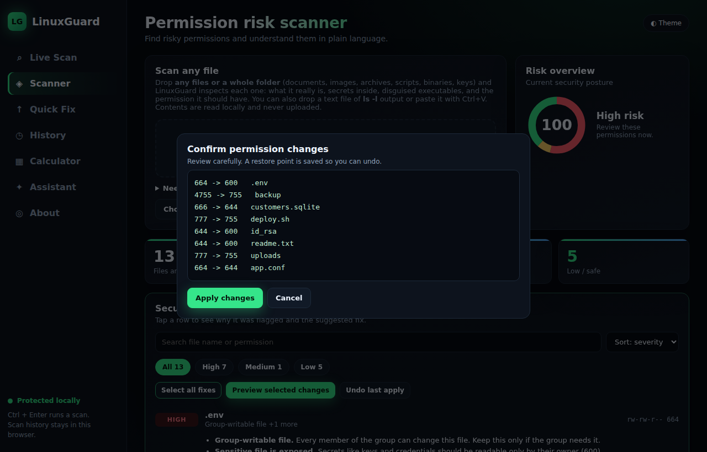
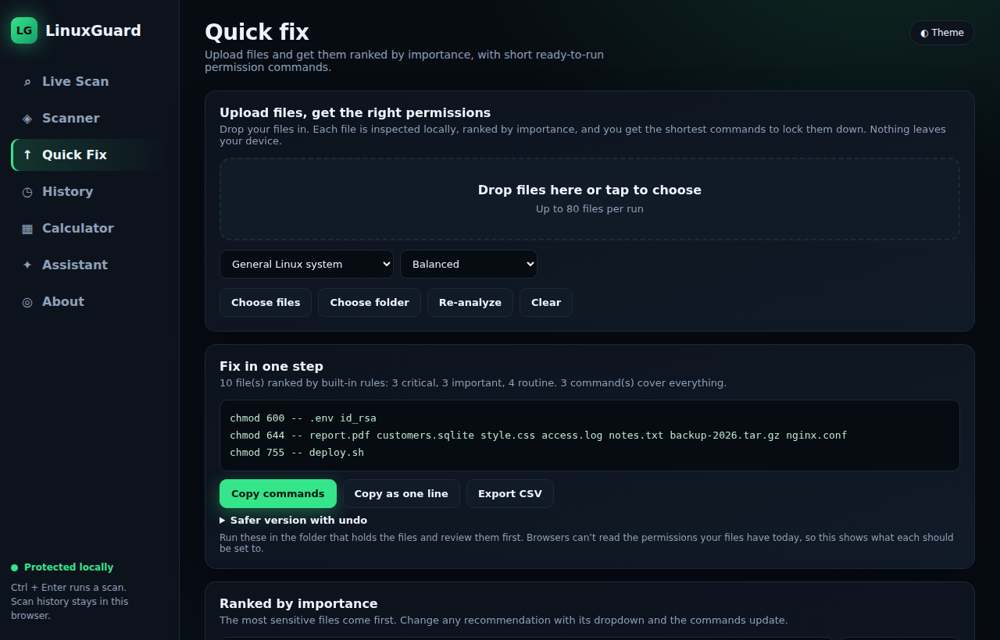

<div align="center">

# LinuxGuard

**Find the files that are one `chmod` away from a breach.**

Scan real folders, rank every file by importance, and fix Linux permissions safely with preview and one-click undo.

[](https://github.com/YOUR-USERNAME/linuxguard/actions/workflows/ci.yml)
[](LICENSE)


[**Website**](https://YOUR-USERNAME.github.io/linuxguard/) &nbsp;|&nbsp; [**Try the web demo**](https://YOUR-USERNAME.github.io/linuxguard/app.html) &nbsp;|&nbsp; [**Download**](https://github.com/YOUR-USERNAME/linuxguard/releases/latest)



</div>

## Why

Wrong permissions quietly cause real breaches: world-writable scripts, private keys readable by everyone, forgotten SUID programs. Checking by hand with `ls -l` does not scale. LinuxGuard reads a folder, scores the risks, explains each one in plain English, and gives you the shortest safe fix.

## Features

| | |
|---|---|
| **Live Scan** | Scan any folder (up to 5,000 entries, 8 levels deep). Reads names and permissions only. |
| **Scan any file type** | Drop files or a folder. Detects the real file type, secrets inside, executables disguised as images, databases, archives, and duplicates (SHA-256). |
| **Importance ranking** | Quick Fix ranks files from critical (keys, credentials) to routine (logs, media) and gives the shortest `chmod` commands. |
| **Apply with undo** | Preview every change, confirm, apply. A restore point is saved so you can roll back instantly. |
| **Drift watch** | Save a baseline, then see new, changed and removed files, optionally every 30 seconds. |
| **Local content hints** | Spots private keys and passwords hiding in innocent file names. Computed on-device, never sent anywhere. |
| **Permission calculator + assistant** | Convert between checkboxes, octal and `rwx`. Ask about permissions, basic commands, hacking basics and common malware. Works offline. |
| **Reports** | Copy CSV, JSON, Markdown or a ready-to-run fix script. |

<p align="center"> </p>

## Quick start

**Option A: download** the latest release from the [Releases page](https://github.com/YOUR-USERNAME/linuxguard/releases/latest) (Windows `.exe` or source zip).

**Option B: run from source.** Needs only Python 3.8+. No packages to install.

```bash
git clone https://github.com/YOUR-USERNAME/linuxguard
cd linuxguard
python3 linuxguard.py          # Windows: py -3 linuxguard.py
```

The app opens in its own window (Edge or Chrome app mode, otherwise your browser). Press `Ctrl+C` in the terminal to quit.

> **Windows note:** Windows does not store Linux permissions, so results there are approximations and *Apply* is disabled. Run LinuxGuard on Linux, macOS or inside WSL for real results. Double-click `scripts/run-wsl.bat`, or in WSL run `python3 linuxguard.py --no-window` and open the printed URL.

## Try the demo

```bash
bash demo-data/demo-setup.sh         # creates ~/linuxguard-demo with deliberately risky (fake) files
python3 linuxguard.py                # then Live Scan -> ~/linuxguard-demo
```

A step-by-step walkthrough is in [`docs/DEMO-GUIDE.txt`](docs/DEMO-GUIDE.txt).

## How it works

```
 App window (ui/index.html)  <-->  Local Python server (127.0.0.1)  <-->  Your files
        interface                    token + CSP + checks                names & permissions
```

A small standard-library Python server serves the interface and does the filesystem work. Nothing talks to the internet and no data leaves your machine.

## Security model

A security tool must not become the weak point. Each control below is covered by [`tests/test_server.py`](tests/test_server.py).

- Listens on `127.0.0.1` only. Wrong `Host`, `Origin` or secret token is rejected.
- Strict Content-Security-Policy and security headers (see [SECURITY.md](SECURITY.md) for the known trade-off).
- Changes require **preview, then confirm**. Each preview code works once and expires after 3 minutes.
- **Refuses** SUID, SGID, sticky and world-writable modes. Never follows or changes symlinks, and changes use open file descriptors. Paths cannot escape the scanned folder.
- Original modes are saved before every change so everything can be restored.
- File contents are never sent or stored. Only local hints (such as "looks like a private key") are computed.

## Project structure

```
linuxguard.py        local server + API (scan, plan, apply, undo)
ui/index.html        the app interface (single file, no build step)
tests/               server tests (unittest)
demo-data/           fake demo files and demo setup script
docs/                GitHub Pages site: landing page + browser demo
scripts/             run helpers, UI syntax check, username personalizer
.github/workflows/   CI, Pages deploy, release builds
```

## Development

```bash
python -m unittest discover -s tests -v   # server tests
python scripts/check_ui.py                # JS syntax check (needs Node.js)
```

## Limitations, and how each is handled

- **Dropped files carry no permissions.** Browsers cannot read them, so the Scanner shows what a file *should* be. For real values use Live Scan, or run `find . -printf '%M %n %u %g %s %TY-%Tm-%Td %TH:%TM %p\n' > listing.txt` on any machine (including remote servers) and drop `listing.txt` into the Scanner.
- **Windows has no Linux permissions**, so Apply is disabled there. `scripts/run-wsl.bat` runs LinuxGuard inside WSL for real results (scan paths under `/home`, not `/mnt/c`).
- **The assistant is rule-based.** It tolerates typos and suggests related questions, but it is not a language model.
- **Scope.** It audits permissions, content signals and common misconfigurations (exposed `.git`, backup leftovers, open Docker socket, risky SSH and sudo settings). It does not find software vulnerabilities, malware signatures or network exposure.
- **Race conditions.** Apply changes permissions through open file descriptors, so neither the file nor any parent folder can be swapped for a symlink mid-apply. Unreadable files fall back to chmod by name, leaving a tiny window for someone who can already write to that folder. Run as a normal user, not root.

## Roadmap

- AI-assisted permission advice (optional, opt-in)
- Linux and macOS packaged builds
- CI check for risky permissions in a repository
- Role-based policy profiles

## Contributing

Issues and pull requests are welcome. See [CONTRIBUTING.md](CONTRIBUTING.md).

## License

[MIT](LICENSE). For educational and defensive use only. Only scan systems you own or are authorized to assess.
